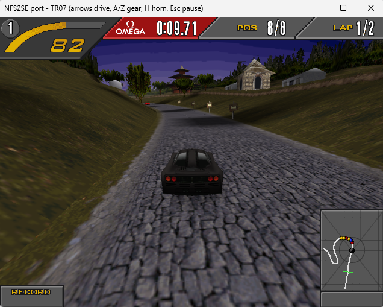

## Intro

Indigo - port of Need for Speed 2 SE made in .NET/mono.

Port is made in .NET/mono game, so potentially it can run on most of the platforms.

I tested it on:
- Windows
- Steam Deck (via wine)

## Features

1. Most of the features from the original game.
2. "Byte to byte" physics, game behaves same as original.
3. Enhanced graphics.
4. Central network server, supporting mutiple games.
5. Some initial modding capabilities added and one example car.

## What you need to play

1. Original game
2. Windows
3. Indigo-*.zip (see releases page)

## Download

Here:

> https://github.com/bl0dcrk-sudo/indigo-public/releases

## How to play

1. Download Indigo-*.zip
2. Extract files to the directory, where your original game is located.
3. Run Indigo.exe

## Network mode

Just put the server executable in game directory and run `Indigo-Server.exe`.

Example:

> Indigo-Server.exe --bind 127.0.0.1 --port 10000

## Issues

You can report them directly on github

## Source code

I have to cleanup mess first ;)
